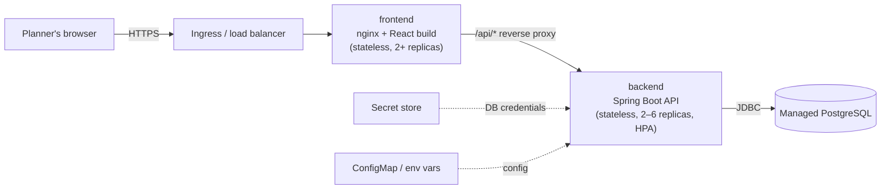

# Cloud-Native Design

## 1. Architecture



| Service | Responsibility | Image | State |
|---|---|---|---|
| **frontend** | Serves the static React build and proxies `/api/*`, so the browser sees one origin | `frontend/Dockerfile` (node build → `nginx:1.27-alpine`) | None |
| **backend** | Validation, optimization, KPIs, REST API | `backend/Dockerfile` (maven build → `eclipse-temurin:21-jre-alpine`, non-root) | Latest run cached in memory (§6) |
| **db** | Orders, vehicles, distance matrix | `postgres:16-alpine` locally; a managed service in the cloud | Persistent |

## 2. API boundaries

All endpoints are under `/api`, return JSON, and report errors as
`{"error": "...", "details": ...}` with the matching HTTP status.

| Area | Endpoints | Notes |
|---|---|---|
| Source data | `GET /orders`, `/vehicles`, `/distances` | Read-only |
| Optimization | `POST /optimization/run` (parameters JSON); `GET /optimization/run`, `/summary`, `/kpis`, `/routes`, `/unallocated[/count\|/reasons]`, `/daily-utilization`, `/daily-type-utilization`, `/parameters/defaults` | `run` validates parameters (400 on invalid) |
| Validation | `GET /validation/report`; `POST /validation/orders` (`text/csv`, ≤ 5 MB) | Upload validation saves nothing |
| Operations | `GET /actuator/health`, `/actuator/health/liveness`, `/actuator/health/readiness` | Used by Docker and Kubernetes probes |

Inside the backend the same boundaries are kept as layers
(controller → service → algorithm/validation → data provider). The algorithm
package has no Spring or database dependencies, so it could become a separate
"optimization worker" service later without changes.

## 3. Containerisation

- **Multi-stage builds:** build tools stay out of the runtime images.
  Dependencies are downloaded in their own layer, so they are cached between
  code changes.
- **Small, non-root runtime images:** the backend runs as user `app` on a JRE
  Alpine image.
- **Container-aware JVM:** `-XX:MaxRAMPercentage=75` sizes the heap from the container's memory limit.
- **Health checks:** the backend `HEALTHCHECK` calls `/actuator/health/liveness`;
  the frontend checks `/`. Compose starts services in order:
  db healthy → backend healthy → frontend.
- **Seed data:** Compose mounts `database/schema.sql` and
  `database/import_data.sql` into `docker-entrypoint-initdb.d`, so a fresh
  database starts populated.

```bash
cp .env.example .env    # set DB_PASSWORD
docker compose up --build
```

## 4. Configuration (12-factor)

Nothing environment-specific is baked into the images. Everything comes from
environment variables, with defaults for local development:

| Variable | Used by | Purpose |
|---|---|---|
| `APP_DATA_SOURCE` | backend | `database` or `csv` (demo/CI without a database) |
| `DB_URL`, `DB_USERNAME`, `DB_PASSWORD` | backend, db | Connection; the password comes from a secret, never from git |
| `DB_POOL_SIZE` | backend | Hikari pool size (default 5) |
| `CORS_ALLOWED_ORIGINS` | backend | Only for direct browser→API calls; not needed behind the nginx proxy |
| `PORT` | backend | Listen port |
| `BACKEND_URL` | frontend | nginx upstream for `/api` |
| `DB_HEALTH_ENABLED` | backend | Disable the DB health indicator in CSV mode |

Kubernetes: non-secret values go in a `ConfigMap`, credentials in a `Secret`
(`deploy/k8s/smart-delivery.yaml`). On a cloud platform the secret would come
from its secret manager (for example AWS Secrets Manager or Azure Key Vault).

## 5. Deployment (Kubernetes reference)

`deploy/k8s/smart-delivery.yaml` contains:
- **Deployments:** `backend` (2 replicas, rolling update with `maxUnavailable: 0`)
  and `frontend` (2 replicas), with CPU and memory requests and limits.
- **Readiness and liveness probes** on the actuator endpoints. The API
  receives traffic only once it is ready, and a hung pod is restarted.
- **Services and an Ingress:** the Ingress is the single public entry point.
- **HorizontalPodAutoscaler:** the backend scales from 2 to 6 replicas at 70% CPU.
- **Graceful shutdown** (`server.shutdown=graceful`): in-flight requests
  finish during rolling updates.

A CI/CD pipeline would run `./mvnw test` and `npm run build`, build and push
both images tagged with the commit SHA, then `kubectl apply` (or Helm/Argo CD).

## 6. Scalability

| Aspect | Current behaviour | Scaling path |
|---|---|---|
| Optimizer cost | 1,800 orders in ≈0.4 s, O(N·V·S²) per day | Comfortable up to tens of thousands of orders per run. Beyond that, partition by hub: hubs are independent, so they can run in parallel |
| Read traffic | Served from the cached latest run (no re-optimization per request, unlike v1.0) | Scale backend replicas horizontally |
| **Run state** | The latest run is kept **in memory per replica**. With several replicas, a custom run on replica A is not visible on replica B | Persist runs (an `optimization_run` table or Redis) keyed by `runId`, and have clients request `?runId=`. Until then, use 1 replica or sticky sessions for the Optimize screen |
| Long runs | Synchronous `POST /run` | Make it asynchronous: return `202` + `runId`, process on a worker queue, and let the client poll |
| Database | 3 small tables; read once per run | Managed PostgreSQL with automated backups; read replica if needed |
| Static UI | nginx with long-lived caching for hashed assets | CDN in front of the Ingress |

## 7. Security

- No credentials in source control: `application.properties` and
  `import_data.py` read environment variables, `.env` is git-ignored and
  `.env.example` documents the variables.
- **Action required:** the v1.0 commit `ff150f4` contains a real database
  password in its history. Rotate that password. If the repository is public,
  also consider rewriting its history.
- Uploads are capped at 5 MB, parsed in memory and never stored.
- Only the `health` and `info` actuator endpoints are exposed.
- Containers run as non-root; the database is not published outside the Compose network.

## 8. Observability

- Structured application logs: each run logs its run ID, trips, allocated and
  unallocated counts, days and runtime.
- The health endpoints feed the orchestrator.
- Next step: add `micrometer-registry-prometheus` and expose `/actuator/prometheus`
  for request latency and optimizer-runtime dashboards.
